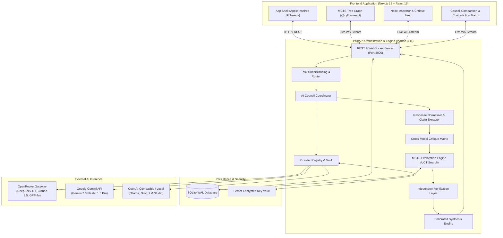
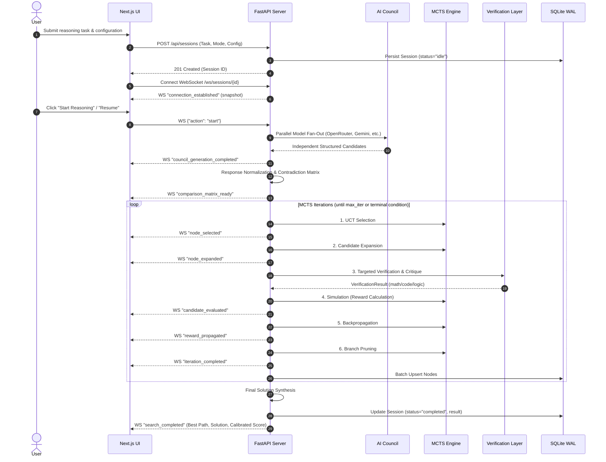

# Deep Reason — System Architecture Specification

> **Autonomous Multi-AI Reasoning & Decision-Making Platform**  
> **Core Mathematical Concept:** Monte Carlo Tree Search (MCTS) with Multi-Model AI Council, Structured Critique, and Independent Verification.

---

## 1. System Overview & Philosophy

Deep Reason is engineered to solve complex, high-stakes reasoning problems by replacing opaque single-turn LLM generation with **System-2 style deliberative computation**.

Rather than relying on raw model confidence or majority consensus, the platform operates on five foundational principles:
1. **Ask Broadly:** Query diverse, independent frontier AI models in parallel without cross-contamination.
2. **Deconstruct & Cluster:** Normalize answers into atomic claims, assumptions, and solution steps, clustering agreements and isolating contradictions.
3. **Cross-Model Adversarial Critique:** Deploy rotating critic models to stress-test premises, spot subtle logical fallacies, and identify violated constraints.
4. **MCTS State-Action Exploration:** Organize alternative reasoning paths, repair steps, and contradiction resolutions into a formal Monte Carlo Tree Search graph guided by the Upper Confidence Bound for Trees (UCT).
5. **Deterministic Verification & Calibrated Synthesis:** Validate verifiable claims using sandboxed computation, symbolic math, or static rule engines, synthesizing a final answer that explicitly states assumptions, limitations, and remaining uncertainties.

---

## 2. High-Level Architecture Diagram

---

## 3. Core Component Responsibilities

### A. Task Understanding & Routing (`engine/router.py`)
- Analyzes incoming user queries, context, constraints, and requested format.
- Classifies problem into domain categories:
  - *Mathematical & Numerical Proofs*
  - *Software & Algorithmic Design*
  - *Factual Research & Synthesis*
  - *Constrained Planning & Optimization*
  - *Logical Deduction & Constraint Satisfaction*
  - *Open-Ended / Subjective Reasoning*
- Determines execution mode:
  - **Quick Mode:** Single high-speed model with optional deterministic verification.
  - **Council Mode:** Parallel multi-model consultation, contradiction matrix, critique, and synthesis.
  - **Deep Reasoning Mode:** Full multi-model council + MCTS state-action exploration + cross-critique + verification + calibrated synthesis.
- Allocates resource budget (max iterations, token ceiling, latency timeout, concurrency cap).

### B. AI Provider Registry, Adapters & Request Execution Layer (`providers/`)
- Unified interface for diverse inference endpoints:
  - `openrouter`: Gateway to DeepSeek R1, Claude 3.5 Sonnet, GPT-4o, Llama 3.3, and 200+ models with reasoning & structured JSON support.
  - `gemini`: Direct Google AI Gemini endpoint supporting Gemini 2.0 Flash and 1.5 Pro with native 2M context windows.
  - `openai_compatible`: Standardized adapter for cloud OpenAI, Groq LPU, and local inference (Ollama, LM Studio, vLLM) with automatic localhost unconfigured bypass.
- **Request Execution Layer (`providers/executor.py`):**
  - Per-provider concurrency throttling via `asyncio.Semaphore` (max 6 concurrent requests per provider).
  - Exponential backoff with jitter retry engine for transient HTTP errors ($429$, $500$, $502$, $503$, $504$, connection timeouts).
  - Immediate fail-fast rejection for non-retryable authentication and client errors ($400$, $401$, $403$, $404$).
  - High-precision wall-clock latency measurement (`latency_ms`) and token usage tracking (`UsageMetadata`).
- **Security & Masking:**
  - API keys are encrypted at rest using AES-GCM / Fernet with SHA-256 derived keys and are **never** transmitted to browser clients.
  - Automatic error message sanitization strips authorization headers, bearer tokens, and raw keys from logs and client responses.
- **Server Endpoints:**
  - `GET /api/providers`: Returns registered provider statuses with masked keys and available models.
  - `GET /api/models`: Aggregates all reasoning models across providers with capability flags.
  - `POST /api/models/test`: Live model testing probe returning normalized latency, tokens, and errors.
  - `POST /api/providers/{name}/test` and `/health`: Live provider connectivity and latency probe.

### C. Parallel AI Council & Normalizer (`engine/council.py`, `engine/normalizer.py`)
- Dispatches identical task prompts independently to all enabled, eligible models in parallel.
- Disables model cross-talk during generation to avoid groupthink and premature convergence.
- Normalizes disparate unstructured responses into structured candidate schemas:
  - Main proposed conclusion
  - Discrete atomic claims
  - Explicit assumptions
  - Proposed logical steps
  - Supporting evidence
  - Unresolved uncertainties
- Constructs a **Comparison Matrix**:
  - Semantic consensus clusters (points of agreement)
  - Direct logical or factual contradictions
  - Unique minority hypotheses
  - Unsupported assertions requiring verification

### D. Structured Adversarial Critique Engine (`engine/critique.py`)
- Implements rotating cross-model evaluation where Model $B$ inspects Model $A$'s candidate.
- Scrutinizes steps against specific failure modes:
  - Logical non-sequiturs
  - Violated task constraints
  - Factual misstatements
  - Missing boundary conditions
- Isolates disputed claims and generates targeted probe queries rather than rerunning the whole prompt.

### E. MCTS Exploration Engine (`engine/mcts.py`)
- Operates on formal search states and actions:
  - **State ($s$):** Cumulative reasoning trajectory, validated facts, active constraints, and remaining contradictions.
  - **Action ($a$):** Discrete next reasoning step, hypothesis repair, contradiction resolution, or boundary test.
  - **Selection:** Traverses tree via UCT formula:
    $$UCT(s, a) = Q(s, a) + c \times \sqrt{\frac{\ln(N(s) + 1)}{N(s, a) + \epsilon}}$$
    where $c$ is the exploration constant (default $\sqrt{2} \approx 1.414$), $Q(s, a)$ is the accumulated mean reward, and $N(s, a)$ is the visit count.
  - **Expansion:** Draws candidates from the multi-model candidate pool or requests targeted step completions.
  - **Simulation / Evaluation:** Assigns reward $R \in [0.0, 1.0]$ based on evaluator critique and independent verification outcomes.
  - **Backpropagation:** Propagates scalar rewards along the selected path, updating ancestor $N$ and $W$ statistics.
  - **Pruning:** Prunes suboptimal branches ($N \ge 2, Q < \theta_{\text{prune}}$) while preserving the top trajectory.

### F. Independent Verification Layer (`engine/verifier.py`)
- Separates subjective model confidence from verifiable objective proof:
  - **Math:** Deterministic computation and algebraic checking (e.g. `SymPy`, Python arithmetic).
  - **Code:** Sandboxed static analysis, syntax validation, and unit-test execution.
  - **Logic:** Formal propositional checks, constraint satisfaction checking.
  - **Research:** Claim-level source attribution and citation checking.
- Returns a distinct `VerificationResult` recording pass/fail, error trace, and verification method.

### G. Calibrated Synthesis Engine (`engine/synthesizer.py`)
- Ingests optimal MCTS path, council consensus points, resolved contradictions, and verification logs.
- Produces a single, coherent, polished final answer.
- Explicitly states:
  - Verified assertions vs. heuristic conclusions
  - Governing assumptions and boundary limitations
  - Calibrated uncertainty interval (does not fabricate consensus if evidence is split)

---

## 4. Data Flow Lifecycle

---

## 5. Security & Isolation Architecture

1. **API Key Encryption at Rest:**
   Keys are never stored in plaintext in SQLite or logs. Symmetric Fernet encryption keys are derived from `SECRET_KEY` using SHA-256. Plaintext keys are decrypted only in-memory immediately prior to external HTTP requests.
2. **Client-Side Key Masking:**
   Any API response transmitting provider details strips the key or returns a secure mask (e.g. `sk-or-••••7890`).
3. **CORS & Network Boundaries:**
   Restricted to designated local and production web origins (`CORS_ORIGINS`).
4. **Sandboxed Verification Safety:**
   Code-execution verification runs with strict timeout constraints and restricted environments to prevent arbitrary host code execution.
5. **Rate-Limiting & Cost Guardrails:**
   Configurable token limits, maximum iterations, and concurrency ceilings prevent infinite recursive tree expansions and runaway provider charges.
