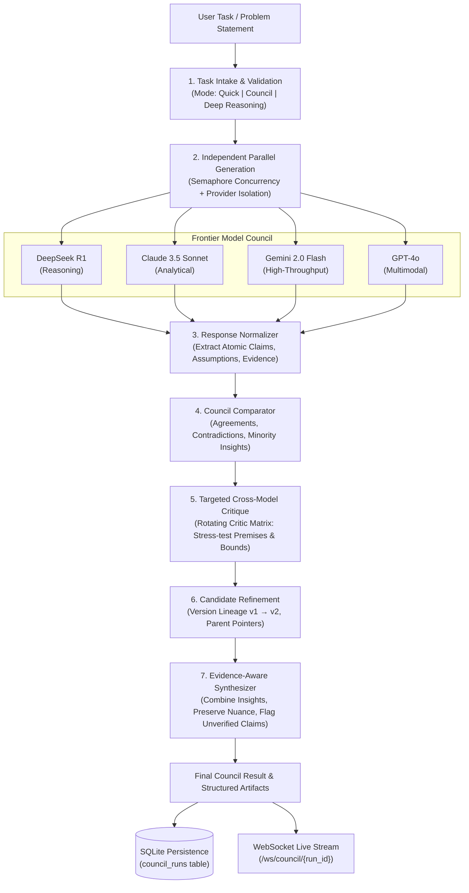

# Deep Reason — AI Council Architecture Specification

> **Autonomous Multi-AI Deliberation, Cross-Model Critique & Evidence-Aware Synthesis**  
> **Phase 2 Implementation Baseline**

---

## 1. Architectural Overview & Execution Flow

The **AI Council** is the deliberative System-2 engine of Deep Reason. It replaces single-model generation with an orchestrated, multi-agent pipeline combining independent consultation, contradiction detection, targeted peer critique, candidate refinement, and evidence-aware synthesis.



---

## 2. Pipeline Modules & Responsibilities

### A. Task Intake & Validation (`backend/engine/council.py`)
- Validates question length ($3 \le \text{chars} \le 12,000$).
- Resolves operating mode:
  - **Quick Mode:** Fast single-model query for low latency.
  - **Council Mode:** Full multi-model independent consultation, comparison, peer critique, refinement, and synthesis.
  - **Deep Reasoning Mode:** Full council workflow with explicit notice that MCTS graph rollouts are pending Phase 3 & 4.
- Resolves participating models against [`ProviderRegistry`](file:///d:/Deep%20Reason/backend/providers/registry.py).
- Enforces budget constraints (concurrency limit, timeout, max critique rounds).

### B. Independent Parallel Generation (`backend/engine/council.py`)
- Dispatches identical user query independently to each selected model using `asyncio.gather` bounded by `max_parallel_models`.
- Preserves model isolation: no model sees peer answers during initial generation.
- Error isolation: failures or timeouts from one provider do not abort successful responses from other models.
- If provider credentials are not populated in `.env`, the engine employs algorithmic heuristic deliberation without fabricating external API calls.

### C. Claim & Evidence Normalization (`backend/engine/normalizer.py`)
- Normalizes unstructured text or JSON into [`CandidateResponse`](file:///d:/Deep%20Reason/backend/models/council.py) and discrete [`AtomicClaim`](file:///d:/Deep%20Reason/backend/models/council.py) elements.
- Classifies claims into: `factual`, `mathematical`, `logical`, `interpretive`, `subjective`.
- Initializes claim status to `unverified`: model agreement is **never** treated as automatic proof.

### D. Agreement & Contradiction Analysis (`backend/engine/comparator.py`)
- Inspects candidates across seven explicit categories:
  1. **Agreement:** Semantic alignment on core conclusions and numerical results.
  2. **Contradiction:** Mutually exclusive assertions under the same assumptions (e.g. converges vs diverges).
  3. **Complementary:** Unique, valuable details discovered by a subset of models.
  4. **Missing Information:** Problem constraints omitted by candidates.
  5. **Unsupported Assertions:** Claims asserted without supporting proof or derivation.
  6. **Assumption Differences:** Apparent disagreements caused by differing starting premises.
  7. **Uncertainty:** Unresolved questions requiring targeted testing.
- Calculates documented consensus ratio:
  $$\text{Consensus Ratio} = \frac{N_{\text{agreements}}}{N_{\text{agreements}} + N_{\text{contradictions}} + 1}$$

### E. Targeted Cross-Model Critique (`backend/engine/critique.py`)
- Rotates eligible critic models to review leading candidates or disputed claims.
- Evaluates:
  - Logical consistency and non-sequiturs
  - Arithmetic or mathematical slips
  - Missed boundary conditions (e.g. $x = 0$, negative roots, limit behavior)
  - Violated task constraints
- Records structured [`CritiqueResult`](file:///d:/Deep%20Reason/backend/models/council.py) with objection severity (`low`, `medium`, `high`, `critical`) and resolution status (`accepted`, `rejected`, `partially_accepted`, `unresolved`).

### F. Candidate Refinement & Versioning (`backend/engine/refinement.py`)
- Re-prompts the candidate model with accepted peer critiques to repair fallacies.
- Preserves original candidate ($v_1$) and creates new refined candidate ($v_2$) with explicit parent pointer (`parent_id = v1.id`).
- Records [`CandidateRefinement`](file:///d:/Deep%20Reason/backend/models/council.py) detailing accepted critiques and changes made.

### G. Evidence-Aware Synthesis Engine (`backend/engine/synthesizer.py`)
- Synthesizes active candidates, consensus points, contradictions, and accepted peer critiques into one authoritative final answer.
- Explicitly separates validated facts from unverified model assertions.
- Preserves material minority viewpoints and highlights remaining uncertainties.

---

## 3. MCTS Integration Contract (`backend/engine/mcts_contract.py`)

Although MCTS state-action rollouts are scheduled for Phase 3 and Phase 4, Phase 2 implements formal integration contracts so MCTS can consume Council candidates and critiques without code rewrites:

```python
class CouncilMCTSContract(ABC):
    @abstractmethod
    async def get_initial_candidates(self, task: str, models: Optional[List[Dict[str, str]]] = None) -> List[CandidateResponse]:
        """Provides initial root candidate branches for MCTS initialization."""
        pass

    @abstractmethod
    async def expand_branch(self, request: CouncilMCTSNodeExpansionRequest) -> List[CandidateResponse]:
        """Generates candidate reasoning actions to expand a selected tree node."""
        pass

    @abstractmethod
    async def evaluate_candidate(self, request: CouncilMCTSEvaluationRequest) -> CouncilMCTSEvaluationResult:
        """Evaluates a candidate branch node using multi-model critique rubric, returning scalar reward in [0.0, 1.0]."""
        pass

    @abstractmethod
    async def refine_branch(self, request: CouncilMCTSRefinementRequest) -> CandidateResponse:
        """Produces a repaired candidate version for an MCTS backtrack/repair step."""
        pass
```

---

## 4. REST & WebSocket Endpoints

| Method | Endpoint | Description |
| :--- | :--- | :--- |
| `POST` | `/api/council/runs` | Intake and launch autonomous Council deliberation run |
| `GET` | `/api/council/runs` | List historical and active Council runs |
| `GET` | `/api/council/runs/{run_id}` | Retrieve complete run state and synthesis |
| `GET` | `/api/council/runs/{run_id}/candidates` | Retrieve individual model responses & versions |
| `GET` | `/api/council/runs/{run_id}/comparison` | Retrieve comparison matrix and consensus ratio |
| `GET` | `/api/council/runs/{run_id}/critiques` | Retrieve structured cross-model critiques |
| `GET` | `/api/council/runs/{run_id}/synthesis` | Retrieve evidence-aware synthesized final answer |
| `POST` | `/api/council/runs/{run_id}/cancel` | Cancel an in-progress Council run |
| `WS` | `/ws/council/{run_id}` | Live event stream of phase transitions and findings |
