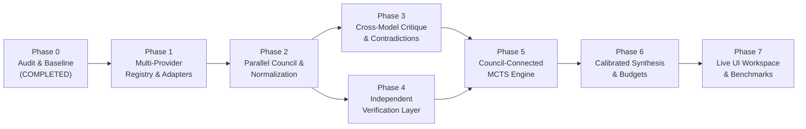

# Deep Reason — Phased Implementation Roadmap

> **Engineering Roadmap from Verified Baseline to Full Autonomous Deliberation Engine**

---

## 1. Phase Progression Overview

---

## 2. Detailed Phase Specifications

### Phase 0: Repository Audit & Engineering Baseline (Status: VERIFIED)
- **Goal:** Comprehensive audit of entire full-stack repository, verifying dependencies, execution paths, database models, tests, and visual interface across viewports and themes.
- **Completion Gates:**
  - Full codebase inspection and defect identification.
  - Verification of backend test suites (`test_backend.py`, `test_websocket.py`).
  - Next.js production build and TypeScript compilation pass with 0 errors.
  - Creation of core documentation: `IMPLEMENTATION_STATUS.md`, `ARCHITECTURE.md`, `ROADMAP.md`, `DEVELOPMENT.md`.

---

### Phase 1: Real Multi-Provider AI Infrastructure (Status: VERIFIED)
- **Goal:** Build robust, production-grade provider adapters with standardized data contracts, latency tracking, retry backoff, and error reporting.
- **Scope & Deliverables:**
  - `providers/base.py`: Updated abstract base class with standardized `generate_structured`, `generate_text`, `count_tokens`, `health_check`.
  - `providers/openrouter.py`: Primary multi-model gateway supporting DeepSeek R1, Claude 3.5 Sonnet, GPT-4o, o3-mini with token usage and error classification.
  - `providers/gemini.py`: Direct Google Gemini REST adapter with OpenAI-compatible endpoint and v1beta fallback.
  - `providers/openai_compatible.py`: Generic endpoint supporting local Ollama, Groq LPU, and vLLM with auto localhost detection.
  - Request execution layer (`providers/executor.py`) with concurrency semaphore, exponential retry with jitter, and credential masking.
  - Fixed route URL discrepancies (`/configure`, `/test`, `/models`).
- **Completion Gate:** Provider integration test suite (`test_providers.py`) passes 100%; keys masked, concurrency throttled, latency measured.

---

### Phase 2: Autonomous Multi-AI Council, Cross-Model Critique & Evidence-Aware Synthesis (Status: VERIFIED)
- **Goal:** Execute parallel, independent queries to all eligible models without cross-contamination, followed by structured extraction, contradiction analysis, targeted peer critique, candidate refinement, and evidence synthesis.
- **Scope & Deliverables:**
  - `models/council.py`: Strongly typed data contracts for `AtomicClaim`, `CandidateResponse`, `ComparisonFinding`, `CritiqueResult`, `CandidateRefinement`, `CouncilSynthesis`, `CouncilRunState`.
  - `engine/council.py`: Full asynchronous Council orchestration pipeline managing run lifecycle, timeouts, concurrency, and event streaming.
  - `engine/normalizer.py`: Extracts atomic claims, assumptions, evidence, and categorizes claims into factual, mathematical, logical, interpretive, or subjective.
  - `engine/comparator.py`: Identifies agreements, contradictions, unsupported assertions, and complementary insights, calculating documented consensus ratio.
  - `engine/critique.py`: Rotating peer critique matrix stress-testing premises, boundary conditions, and logical validity.
  - `engine/refinement.py`: Candidate revision engine preserving version lineage (v1 -> v2) with parent pointers and accepted critique references.
  - `engine/synthesizer.py`: Generates coherent, evidence-aware final answer, distinguishes model assertions from verified facts, states assumptions, and handles Quick, Council, and Deep Reasoning modes.
  - `engine/mcts_contract.py`: Stable abstract contracts for future Phase 3/4 MCTS search engines to consume candidates and critiques without code rewrites.
  - `db/schema.sql` & `db/repository.py`: Persistence for council runs in `council_runs` SQLite table.
  - `components/council/council-workspace.tsx` & `/workspace`: Apple-inspired interactive frontend showing run overview, independent models, comparison matrix, peer critiques, lineage, and synthesis.
- **Completion Gate:** Automated test suite (`test_council.py`) passes 100% covering all stages; live execution verified; Next.js production build passes with 0 errors.

---

### Phase 3: Structured Cross-Model Critique & Contradiction Analysis
- **Goal:** Adversarial peer review where models test each other's candidates, detect contradictions, and isolate points of disagreement.
- **Scope & Deliverables:**
  - `engine/critique.py`: Cross-model critique matrix rotating critic models against candidate generators.
  - Structured critique rubric: checks logical entailment, constraint satisfaction, boundary cases, and factual claims.
  - Contradiction graph isolating contested assertions for targeted search.
  - Preservation of separate records for initial answers, critiques, and revised candidates.
- **Completion Gate:** Contradiction detection test passes on counter-example problem sets; critique scores do not penalize valid minority answers without evidence.

---

### Phase 4: Independent Multi-Domain Verification Layer
- **Goal:** Objective verification for checkable claims, separating subjective heuristic confidence from deterministic proof.
- **Scope & Deliverables:**
  - `engine/verifier.py`: Verification dispatcher routing by problem domain.
  - `engine/verifiers/math_verifier.py`: Deterministic arithmetic, symbolic computation (SymPy), equation balance checks.
  - `engine/verifiers/code_verifier.py`: Sandboxed Python syntax and AST validator with restricted execution environment.
  - `engine/verifiers/logic_verifier.py`: Propositional consistency and rule-based constraint validation.
  - Structured `VerificationResult` contract recording pass/fail, error trace, and verification method.
- **Completion Gate:** 100% detection of arithmetic fallacies and syntax errors in automated test suites without host security risks.

---

### Phase 5: Council-Connected MCTS Exploration Engine
- **Goal:** Connect Monte Carlo Tree Search directly to the multi-model candidate pool, using search to resolve contradictions, repair flawed steps, and explore promising alternative trajectories.
- **Scope & Deliverables:**
  - Redesign `MCTSNode` state to represent explicit reasoning states, active hypotheses, and resolved facts.
  - Tree actions represent meaningful steps: exploring alternative council strategies, repairing critique-flagged errors, or testing assumptions.
  - Evaluation combines heuristic model critique with deterministic verification outcomes.
  - Dynamic UCT selection policy with unvisited node exploration bonus and documented reward propagation.
- **Completion Gate:** Verified MCTS run where branches with verified contradictions are pruned while sound minority reasoning paths are expanded and selected.

---

### Phase 6: Calibrated Synthesis & Adaptive Resource Budgeting
- **Goal:** Produce coherent, unified final answers that transparently communicate verified facts, explicit assumptions, and calibrated uncertainty.
- **Scope & Deliverables:**
  - `engine/synthesizer.py`: Evidence-based synthesis engine combining optimal MCTS path, consensus clusters, and critique resolutions.
  - Uncertainty calibration: Explicitly flags disputed claims where evidence is inconclusive; never manufactures artificial consensus.
  - `engine/budget.py`: Adaptive resource allocation enforcing ceilings on initial calls, critique cycles, MCTS iterations, token spend, and wall-clock latency.
  - Dynamic early stopping when verified solution or confident consensus is reached.
- **Completion Gate:** Benchmark test measuring budget adherence (token and time limits never exceeded) and calibrated synthesis output.

---

### Phase 7: Live UI Integration & Benchmarking Harness
- **Goal:** Surface the entire multi-AI deliberation lifecycle in the existing Apple-inspired frontend, and build automated empirical benchmarking.
- **Scope & Deliverables:**
  - Workspace UI integration: Live tabs for Council Comparison Matrix, Cross-Model Critiques, MCTS Tree, and Verification Badges.
  - Benchmarks Page (`/benchmarks`): Implement automated benchmarking suite comparing:
    - Baseline Single Model
    - Multi-Model Aggregation
    - Council with Cross-Critique
    - Council with MCTS & Independent Verification
  - Empirical metrics: Correctness, constraint satisfaction, token usage, latency, and cost per run.
- **Completion Gate:** Full end-to-end execution visible in the web UI, backed by real WebSocket events and reproducible benchmark runs.

---

## 3. Major Implementation Risks & Mitigation Strategies

| Risk | Impact | Mitigation Strategy |
| :--- | :--- | :--- |
| **API Rate Limits ($429$) & Provider Outages** | High | Asynchronous concurrency throttling, token-bucket rate limiters, exponential backoff with jitter, and graceful fallback to surviving providers. |
| **Excessive Latency in Multi-Model Fan-Out** | Medium | Parallel `asyncio.gather` requests, strict per-call timeouts ($15-30$s), and `QUICK` mode option for time-sensitive tasks. |
| **Unsafe Model Code Execution** | Critical | Strict AST parsing, sandboxed sub-processes with zero network access, memory limits, and timeouts; no unrestricted `exec` or `eval`. |
| **Hallucinated Heuristic Rewards** | High | Decouple objective `VerificationResult` from model evaluation scores; label unverified scores as heuristic estimates in UI. |
| **Context Window Overhead** | Medium | Strict response normalization; summarize historical context in state rather than passing full conversational chain-of-thought. |
